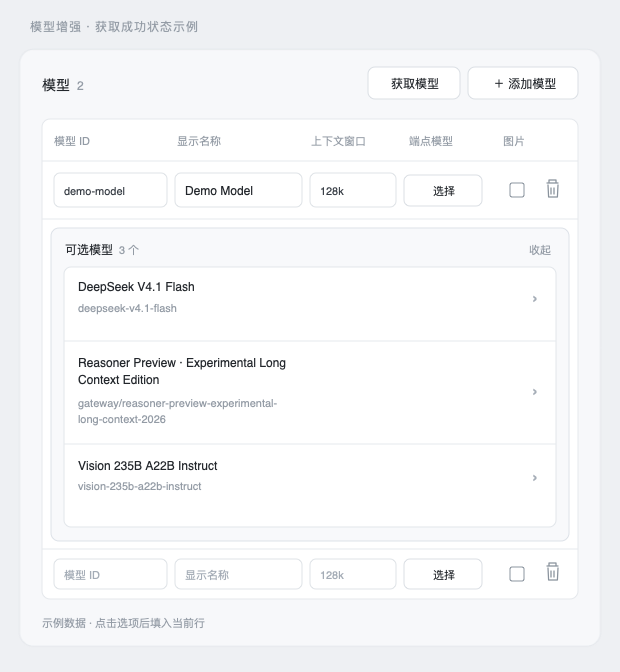

# dsh-provider-plus（模型增强）

给 DeepSeek Harness 的「自定义模型提供商」补上内置表单缺的几件事：图片输入、网关额外请求头（如 `x-opencode-session`）、拉取模型列表、连通性测试、用量测试 / 余额查询模板，以及在输入框旁跟随当前模型显示的用量总览。

它不写协议、不接管内置页面：改的仍是 `llm-pi-ai.providers`，**设置 → 模型** 照旧可用，只是多了一个 **设置 → 模型增强** 工作台。细节见[使用说明](./docs/guide.md)。

## 界面示例

下图是“获取模型”成功后的示例状态，模型名称和数据仅用于展示布局。可查看[交互预览](./docs/previews/model-picker-success.html)。

## 安装

见 [**DSH 插件安装教程**](https://github.com/DPH-1121/dsh-plugins/blob/main/docs/install.md)。

## 兼容性

基线 **dsh `0.2.1-rc.5`**：清单通过 rc.5 的插件闸门、可装入隔离 profile 并 `--dump-config` 组合成功，`npm run test`（smoke）通过；`engines.dsh` 同时保留 `0.1.6` 起的旧窗口。

已在 **dsh `0.2.2-rc.1`** 上实测：清单通过插件闸门、可装入隔离 profile 并 `--dump-config` 组合成功，`/state`、`/provider`、`/models`、`/discover`、`/probe`、`/usage` 六条路由全部走通，设置页在真实浏览器里正常渲染。同一条代码在 `0.2.1-rc.5`／`0.2.1-rc.2` 上也验证过。

`0.2.2` 给 `llm-pi-ai` 的路由新增了 `maxRequestImages` / `imageOffloadCountQuantum`（单次请求图片数与每次卸载张数）。这两个字段由本插件补进编辑器——内置的「模型」页并不提供它们。是否显示不靠版本号判断，而是读 `settings.describe()` 里 `llm-pi-ai` 的真实 schema：新版显示并写入，旧版隐藏且拒写，保存后提示「当前 dsh 的 llm-pi-ai 不支持…」。其余路由选项保持原样，不会被改写。

## 其他 DSH 插件

- [dsh-opencode-go-plus](https://github.com/DPH-1121/dsh-opencode-go-plus) —— 用 OpenCode Go 订阅模型，自动适配网关新模型并显示套餐额度。
- [dsh-wallhaven-wallpaper](https://github.com/DPH-1121/dsh-wallhaven-wallpaper) —— 在设置里搜 wallhaven，把图片铺成 Web GUI 背景。
- [dsh-plugins](https://github.com/DPH-1121/dsh-plugins) —— DSH 插件搜集面板：搜仓库、复制安装地址。

## 许可

MIT。
